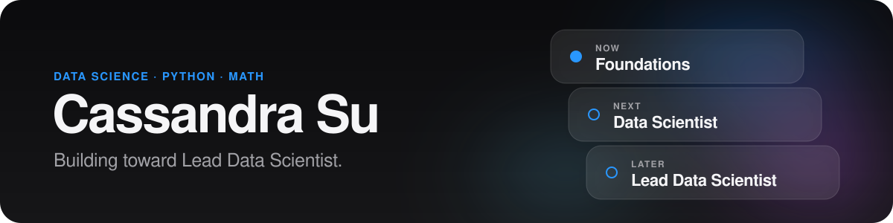

  

**Aspiring Data Scientist, building toward Lead Data Scientist.** I connect machine learning with AI strategy and organizational leadership, so that data turns into decisions.

[Repositories](https://github.com/cassieorcasey?tab=repositories) · [Cassandra Suite](#cassandra-suite) · [Career path](#career-path)

---

## Start here

| Repo | Why |
|---|---|
| [My-Learn-Python-Fundamentals](https://github.com/cassieorcasey/My-Learn-Python-Fundamentals) | My Python foundation: syntax, data structures, OOP |
| [practice-math](https://github.com/cassieorcasey/practice-math) | Step-by-step math tutor skill (EN + ID), a prompt-design project |
| [StudyO](https://github.com/cassieorcasey/StudyO) | How I track and measure my own learning |
| [budget-saver](https://github.com/cassieorcasey/budget-saver) | Envelope budgeting synced to my own Google Sheets |

## Career path

| Stage | Focus |
|---|---|
| **Now** | Python, discrete mathematics, algebra |
| **Next** | Statistics, data analysis, ML models, end-to-end projects |
| **Later** | AI strategy, project scoping, mentoring, communicating results to stakeholders |

## Learning

[My-first-Python](https://github.com/cassieorcasey/My-first-Python) · [My-Learn-Python-Fundamentals](https://github.com/cassieorcasey/My-Learn-Python-Fundamentals) · [practice-math](https://github.com/cassieorcasey/practice-math)

## Cassandra Suite

A small suite of personal apps that support my study routine and daily systems.

| App | What it does |
|---|---|
| [StudyO](https://github.com/cassieorcasey/StudyO) | Study sessions, breaks, topic goals, weekly streak |
| [budget-saver](https://github.com/cassieorcasey/budget-saver) | Envelope-style budgeting in my own Google Sheets, synced across iPhone and Windows |
| [wishmap](https://github.com/cassieorcasey/wishmap) | Interactive shopping wishlist map with links, prices, and item connections |
| [calorie](https://github.com/cassieorcasey/calorie) | Daily nutrition and calorie tracker |

## Stack

## How I work

Systematic, detail-oriented, problem-solving first. Deep focus, a structured routine, and progress tracked with my own tools.

> Learning in public, one commit at a time.
